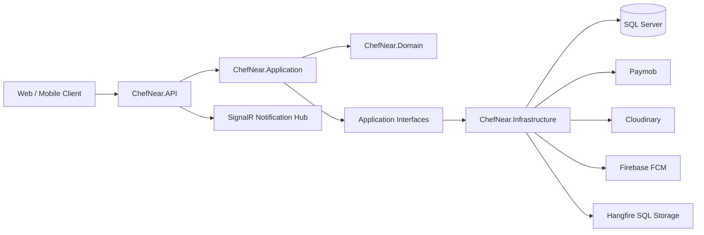

# ChefNear Backend

ChefNear is an ASP.NET Core backend for a chef-to-client marketplace. It provides authentication, profiles, chef and dish discovery, order management, reviews, notifications, wallets, and Paymob payment processing.

**Stack:** ASP.NET Core .NET 10 · Entity Framework Core · SQL Server · ASP.NET Identity · MediatR · FluentValidation · Hangfire · SignalR · Serilog · Swagger/OpenAPI

---

## Architecture Overview

The solution follows a layered, feature-oriented architecture inspired by Clean Architecture and Domain-Driven Design. Dependencies point inward: infrastructure and delivery concerns implement contracts defined by the application and domain layers.



### Request flow

```text
HTTP Controller
  -> MediatR command or query
  -> FluentValidation pipeline behavior
  -> Feature handler
  -> Repository / Unit of Work
  -> EF Core / external service
  -> Result<T>
  -> ApiResponse<T>
  -> HTTP response
```

## Solution Structure

```text
.
├── src/
│   ├── ChefNear.API/
│   │   ├── Controllers/           Versioned REST controllers
│   │   ├── Middlewares/           Global exception handling
│   │   ├── Filters/               HMAC webhook verification
│   │   ├── Extensions/            Swagger/OpenAPI configuration
│   │   ├── EmailTemplates/        Account email templates
│   │   └── Program.cs             Composition root and HTTP pipeline
│   │
│   ├── ChefNear.Application/
│   │   ├── Features/              Feature-based commands and queries
│   │   ├── Common/               Behaviors, jobs, payments, and persistence contracts
│   │   ├── Interfaces/           Cross-cutting application abstractions
│   │   └── Model/                Application and integration settings
│   │
│   ├── ChefNear.Domain/
│   │   ├── Entities/              Domain entities
│   │   ├── Enums/                 Domain enumerations
│   │   ├── Errors/                Domain error definitions
│   │   └── Exceptions/            Domain-specific exceptions
│   │
│   ├── ChefNear.Infrastructure/
│   │   ├── Persistence/           EF Core DbContext and entity configurations
│   │   ├── Repositories/          Repository and Unit of Work implementations
│   │   ├── Services/              Email, JWT, storage, notifications, and identity services
│   │   ├── Payments/              Payment gateway factory and Paymob integration
│   │   ├── Jobs/                  Hangfire background jobs
│   │   ├── Hubs/                  SignalR notification hub
│   │   ├── Migrations/            EF Core database migrations
│   │   └── Seed/                  Database initialization and seed data
│   │
│   └── ChefNear.Shared/
│       ├── Responses/             Shared API response wrappers
│       ├── ResultPattern/         Success/failure result types
│       └── Constants/             Shared constants
│
└── tests/
    ├── ChefNear.Application.Tests/
    └── ChefNear.Infrastructure.Tests/
```

## Design Patterns

| Pattern | Implementation |
|---|---|
| **Feature-based organization** | Each application capability contains its commands, queries, handlers, DTOs, validators, and mappings |
| **CQRS** | MediatR separates write operations (`IRequest`) from read operations (`IRequest`) by feature intent |
| **Pipeline behavior** | FluentValidation runs before MediatR handlers through `ValidationBehavior<TRequest,TResponse>` |
| **Repository & Unit of Work** | Application contracts are implemented by infrastructure repositories |
| **Dependency Inversion** | Infrastructure integrations are accessed through application interfaces |
| **Result pattern** | Business outcomes are represented with `Result` and `Result<T>` instead of leaking exceptions for expected failures |
| **API response envelope** | Controllers return consistent `ApiResponse` or `ApiResponse<T>` payloads |
| **Factory pattern** | `IPaymentGatewayFactory` resolves the configured payment gateway implementation |
| **Middleware pipeline** | Global exception handling centralizes API error responses and logging |
| **Dependency injection** | API, application, infrastructure, and shared projects register their own services |

## Domain Features

- Authentication, registration, email confirmation, password reset, refresh tokens, and profile management
- Roles and authorization for administrators, chefs, and clients
- Chef and dish discovery, categories, ingredients, and geolocation-based nearby dish queries
- Dish images, addresses, order lifecycle, cancellations, delivery, and refunds
- Reviews and ratings
- Wallet balances and withdrawal processing
- Notifications delivered by SignalR and Firebase Cloud Messaging
- Paymob payment intents and HMAC-verifying payment webhooks
- Background jobs for chef earnings and push notifications

## API and Security

- Deployed Swagger UI: [https://chefnear.runasp.net/swagger/index.html](https://chefnear.runasp.net/swagger/index.html)
- Deployed API base URL: `https://chefnear.runasp.net`
- Versioned routes using URL segments (for example, `/api/v1/dishes`)
- Swagger/OpenAPI with JWT bearer support in the Development environment
- JWT authentication and ASP.NET Identity
- Role-based and policy-aware authorization
- Consistent validation and error responses
- Global exception middleware
- CORS policy
- HMAC verification for payment webhooks
- Serilog console and rolling-file logging

## Integrations

| Integration | Purpose |
|---|---|
| SQL Server / EF Core | Persistence, migrations, Identity storage, and Hangfire storage |
| Hangfire | Scheduled and background processing |
| SignalR | Real-time authorized notifications |
| Firebase Admin / FCM | Push notifications |
| Cloudinary | Image upload and file storage |
| Paymob | Payment intents, refunds, and payment webhooks |
| SMTP / MailKit | Confirmation and password-reset email |

## Prerequisites

- .NET 10 SDK
- SQL Server LocalDB or SQL Server
- Visual Studio 2026 or the .NET CLI
- Accounts and credentials for any external integrations you intend to use

## Local Setup

1. Restore dependencies:

   ```powershell
   dotnet restore .\ChefNear.slnx
   ```

2. Configure the API project for local development.

   The API project has a configured `UserSecretsId`. Prefer user secrets or environment variables instead of placing secrets in source-control files:

   ```powershell
   cd .\src\ChefNear.API
   dotnet user-secrets init
   dotnet user-secrets set "ConnectionStrings:DefaultConnection" "Server=.;Database=ChefNearDB;Trusted_Connection=True;TrustServerCertificate=True;"
   dotnet user-secrets set "JwtSettings:Key" "<your-long-random-signing-key>"
   dotnet user-secrets set "JwtSettings:Issuer" "ChefNear"
   dotnet user-secrets set "JwtSettings:Audience" "ChefNearAPI"
   ```

   Configure additional sections as needed: `EmailSettings`, `Cloudinary`, `Firebase`, `FrontendSettings`, `AppUrlSettings`, and `PaymentGateway:Paymob`.

   > Never commit real credentials. Rotate any secrets that have previously been committed or shared.

3. Apply migrations and run the API:

   ```powershell
   dotnet ef database update --project .\src\ChefNear.Infrastructure --startup-project .\src\ChefNear.API
   dotnet run --project .\src\ChefNear.API
   ```

4. Open the local endpoints:

   - API HTTP: `http://localhost:5114`
   - API HTTPS: `https://localhost:7034`
   - Swagger: `/swagger`
   - Hangfire Dashboard: `/hangfire` (Development only)
   - SignalR hub: `/hubs/notifications`

## Database Migrations

Create a migration from the repository root:

```powershell
dotnet ef migrations add <MigrationName> `
  --project .\src\ChefNear.Infrastructure `
  --startup-project .\src\ChefNear.API `
  --output-dir Migrations
```

Update the database:

```powershell
dotnet ef database update `
  --project .\src\ChefNear.Infrastructure `
  --startup-project .\src\ChefNear.API
```

## Testing

Run the complete test suite:

```powershell
dotnet test .\ChefNear.slnx
```

Run one test project:

```powershell
dotnet test .\tests\ChefNear.Application.Tests\ChefNear.Application.Tests.csproj
dotnet test .\tests\ChefNear.Infrastructure.Tests\ChefNear.Infrastructure.Tests.csproj
```

The test projects use xUnit, FluentAssertions, and Moq.

## Building

```powershell
dotnet build .\ChefNear.slnx --configuration Release
dotnet publish .\src\ChefNear.API\ChefNear.API.csproj --configuration Release
```

## Development Guidelines

- Place HTTP concerns in `ChefNear.API`; never put controller logic in infrastructure or domain projects.
- Implement use cases as feature commands or queries with MediatR handlers.
- Keep FluentValidation rules alongside feature commands and queries.
- Depend on interfaces from `ChefNear.Application`; implement them in `ChefNear.Infrastructure`.
- Use `Result` and `Result<T>` for expected business outcomes and domain errors.
- Keep EF Core entity configuration in `Infrastructure/Persistence/Configurations`.
- Store migrations in the infrastructure project.
- Register services in the appropriate `DependencyInjection.cs` extension.
- Use structured Serilog logging; avoid logging credentials or personal data.
